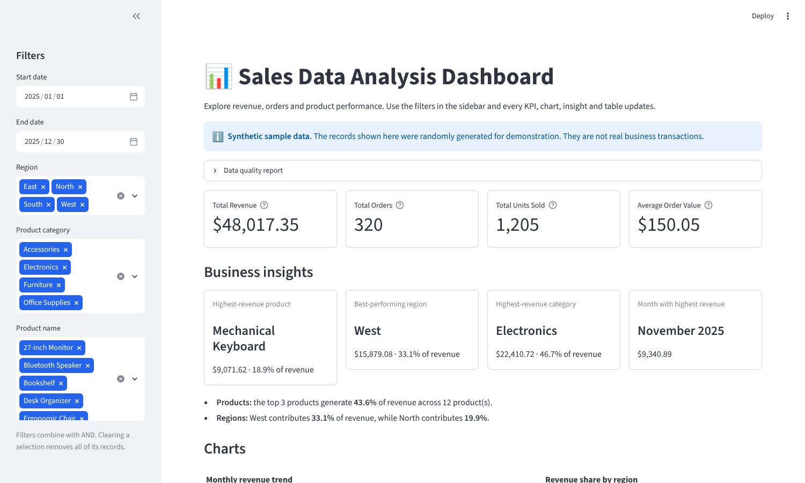
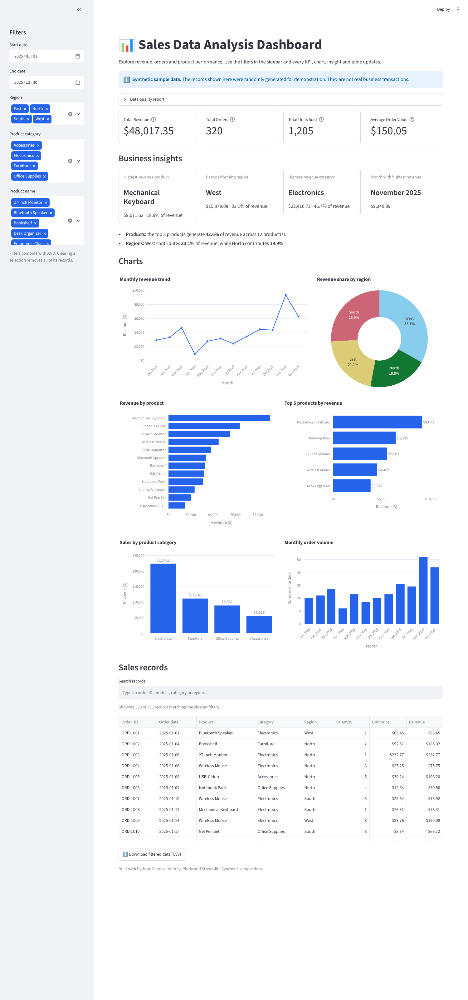

# 📊 Sales Data Analysis Dashboard

An interactive web dashboard that turns a sales CSV into KPIs, charts and business insights, built with **Python, Pandas, NumPy, Plotly Express and Streamlit**.

> **Synthetic data notice:** the included dataset (`data/sales_data.csv`) is randomly generated sample data created with a fixed seed. It does **not** contain real business transactions.

Built as a portfolio project for the CodeNova Internship Program.

---

## Table of contents

1. [Project overview](#project-overview)
2. [Problem statement](#problem-statement)
3. [Features](#features)
4. [Technology stack](#technology-stack)
5. [Project directory structure](#project-directory-structure)
6. [Installation](#installation)
7. [Running the application](#running-the-application)
8. [Running the tests](#running-the-tests)
9. [Dataset description](#dataset-description)
10. [Data-cleaning methodology](#data-cleaning-methodology)
11. [KPI definitions](#kpi-definitions)
12. [Business insights](#business-insights)
13. [Screenshots](#screenshots)
14. [Uploading to GitHub](#uploading-to-github)
15. [Deployment (Streamlit Community Cloud)](#deployment-streamlit-community-cloud)
16. [Implementation status](#implementation-status)
17. [Future improvements](#future-improvements)

---

## Project overview

The dashboard loads a sales CSV, validates and cleans it, and lets a user explore it through filters. Every KPI, chart, insight and table is calculated from the **currently filtered** data, so the numbers always match what is on screen.

Data processing (`utils/data_processing.py`) is kept completely separate from the user interface (`app.py`), so the logic can be tested and reused without Streamlit.

## Problem statement

Raw sales spreadsheets are hard to read. A manager who wants to know *which product earns the most, which region is strongest, or which month performed best* has to build pivot tables by hand, and bad rows (duplicates, negative quantities, broken dates) can quietly distort the answers.

This project automates that work: it cleans the data **transparently** (every excluded row is reported with a reason), then presents the results interactively.

## Features

**Implemented**

- **KPI cards:** Total Revenue, Total Orders, Total Units Sold, Average Order Value.
- **Sidebar filters:** start date, end date, region, product category, product name.
- **Six interactive Plotly charts** with titles, currency formatting and hover details:
  1. Monthly revenue trend (line)
  2. Revenue by product (horizontal bar)
  3. Revenue share by region (donut)
  4. Sales by product category (bar)
  5. Monthly order volume (bar)
  6. Top 5 products by revenue (horizontal bar)
- **Dynamic business insights** (nothing hardcoded): highest-revenue product, best region, top category, best month, and revenue concentration across products and regions.
- **Searchable sales table** plus **CSV download** of the filtered data.
- **Data-quality report** in the app showing loaded / used / excluded rows, removed duplicates and the reason for each excluded row.
- **Error handling:** friendly messages for a missing, empty or malformed file; a warning when filters match no records; a clear error for an invalid date range.
- **Automated tests:** 54 tests (data processing plus headless app smoke tests).

## Technology stack

| Purpose | Library |
|---|---|
| Language | Python 3 |
| Data cleaning and aggregation | Pandas |
| Numerical operations (rounding, infinity handling, random generation) | NumPy |
| Interactive charts | Plotly Express |
| Dashboard UI | Streamlit |
| Dataset format | CSV |
| Testing (development only) | pytest |

Runtime dependencies are listed in `requirements.txt` (four packages, nothing else).
Development dependencies (pytest) are in `requirements-dev.txt`.

## Project directory structure

```
sales-data-analysis-dashboard/
├── app.py                        # Streamlit dashboard (UI and charts only)
├── data/
│   └── sales_data.csv            # Synthetic sample dataset (320 records)
├── utils/
│   ├── __init__.py
│   └── data_processing.py        # Loading, cleaning, filtering, KPIs, insights
├── scripts/
│   ├── __init__.py
│   └── generate_sample_data.py   # Reproducible generator for the sample CSV
├── tests/
│   ├── test_data_processing.py   # Unit tests for the processing module
│   └── test_app_smoke.py         # Headless Streamlit run tests
├── screenshots/                  # Dashboard screenshots used in this README
├── .streamlit/
│   └── config.toml               # Theme colour, usage-stats off
├── requirements.txt              # Runtime dependencies (used by Streamlit Cloud)
├── requirements-dev.txt          # Runtime + pytest
├── pytest.ini                    # Makes `import utils` work in tests
├── .gitignore
└── README.md
```

## Installation

Requirements: Python 3.10 or newer and `pip`. (Developed and tested with Python 3.13, Streamlit 1.66, pandas 3.1, NumPy 2.5 and Plotly 7.1.)

```bash
# 1. Go to the project folder
cd sales-data-analysis-dashboard

# 2. Create a virtual environment
python -m venv .venv

# 3. Activate it
source .venv/bin/activate          # macOS / Linux
.venv\Scripts\activate             # Windows (Command Prompt / PowerShell)

# 4. Install dependencies
pip install -r requirements.txt
```

## Running the application

Run from the project root (the folder that contains `app.py`):

```bash
streamlit run app.py
```

Streamlit prints a local URL (normally <http://localhost:8501>); open it in your browser.

To regenerate the sample dataset (the output is identical every time because the seed is fixed):

```bash
python scripts/generate_sample_data.py
```

To analyse your own data, replace `data/sales_data.csv` with a CSV that has the same seven columns (see below) and restart or refresh the app.

## Running the tests

```bash
pip install -r requirements-dev.txt
python -m pytest
```

The tests cover revenue calculation, missing values, duplicate detection, invalid numbers, empty datasets, filtering, KPIs, insights, CSV export, loading errors, the bundled dataset and the reproducibility of the generator. The smoke tests start the Streamlit app headlessly and check that it renders, that clearing a filter shows a warning instead of crashing, and that an invalid date range shows an error.

## Dataset description

`data/sales_data.csv` contains **320 synthetic orders** from 1 Jan 2025 to 30 Dec 2025, generated by `scripts/generate_sample_data.py` using `numpy.random.default_rng(42)`.

| Column | Type | Description |
|---|---|---|
| `Order_ID` | text | Unique order identifier, e.g. `ORD-1001` |
| `Order_Date` | date (`YYYY-MM-DD`) | Date of the order |
| `Product` | text | One of 12 products |
| `Category` | text | Electronics, Furniture, Office Supplies or Accessories |
| `Region` | text | North, South, East or West |
| `Quantity` | whole number | Units ordered (at least 1) |
| `Unit_Price` | decimal | Price per unit (the dashboard shows it in `$`) |

The generator adds mild seasonality (busier in November and December), varies prices slightly around a base price, and makes cheaper items sell in larger quantities. Each row is one order line; the dashboard also correctly handles an order that has several lines with the same `Order_ID`.

The currency symbol is a single constant (`CURRENCY` in `app.py`) and can be changed.

## Data-cleaning methodology

The pipeline is in `utils/data_processing.py`. The guiding rule is: **never silently change or delete data.** Everything that is excluded is counted and shown in the app's *Data quality report* panel.

| Situation | What the code does | Why |
|---|---|---|
| File missing, empty, header-only, not valid CSV, or required column missing | Stops with a clear error message shown in the app | Nothing meaningful can be analysed |
| Text columns with extra spaces or blank cells | Trims spaces; blank becomes "missing" | Avoids `"East"` and `"East "` counting as different regions |
| Missing `Order_ID`, `Product`, `Order_Date`, `Quantity` or `Unit_Price` | Row **excluded** and reported with the reason | Revenue or order counts cannot be calculated reliably |
| Unparseable date (e.g. `not-a-date`) | Row **excluded** and reported | Cannot be placed in a month |
| Non-numeric quantity or price (e.g. `abc`, `free`, `inf`) | Row **excluded** and reported | Not a valid number |
| Quantity zero or negative | Row **excluded** and reported | Returns and refunds are not modelled; counting them as sales would distort revenue |
| Quantity not a whole number (e.g. `2.5`) | Row **excluded** and reported | Units sold must be whole items (`4.0` is accepted as `4`) |
| Unit price zero or negative | Row **excluded** and reported | Invalid price; free items would also distort Average Order Value |
| Missing `Category` or `Region` | Row **kept**, value set to `Unknown` | The sale is real, so its revenue still counts |
| **Exact duplicates** (all seven fields identical after cleaning) | Keeps the first, removes the rest, reports the count | Almost certainly a double entry |
| Same `Order_ID` and `Product` but different details | **Kept** and flagged in the report | We cannot know which record is correct, so we do not guess |
| Same `Order_ID` with different products | Treated as normal (multi-line order) | Orders can contain several products |
| Revenue | `Quantity × Unit_Price`, rounded to 2 decimals | As specified |

Notes and assumptions:

- A row is reported under the **first** rule it breaks, so the reason counts add up to the number of excluded rows.
- Dates are parsed with pandas' flexible parser; use ISO format (`YYYY-MM-DD`) to avoid day/month ambiguity.
- Months with no sales between the first and last month are shown as zero so charts do not skip over them.

## KPI definitions

All KPIs use the **filtered** data.

| KPI | Calculation |
|---|---|
| Total Revenue | Sum of `Quantity × Unit_Price` |
| Total Orders | Number of **distinct** `Order_ID` values |
| Total Units Sold | Sum of `Quantity` |
| Average Order Value | Total Revenue ÷ Total Orders |

With no matching records, all KPIs are zero and the app shows a warning instead of charts.

## Business insights

The *Business insights* section is recomputed whenever the filters change. It reports:

- the highest-revenue **product**, **region** and **category**, with each one's share of revenue;
- the **month** with the highest revenue;
- **revenue distribution**: the share of revenue held by the top three products, and the gap between the strongest and weakest region.

For example, with the bundled sample data (all filters at their defaults) the dashboard shows Mechanical Keyboard as the top product, West as the top region, Electronics as the top category and November 2025 as the best month. These are properties of the generated sample data, not real findings, and they change if you change the data or filters.

Questions the dashboard helps answer: Which products drive most revenue? Is revenue concentrated in a few products? Which regions are under-performing? Is there seasonality in revenue and order volume?

## Screenshots

Screenshots of the dashboard running on the synthetic sample data (captured from a headless browser session):





To retake them, run the app and save new images over these files in `screenshots/`.

## Uploading to GitHub

1. Create a new **empty** repository on GitHub (no README, no `.gitignore`), for example `sales-data-analysis-dashboard`.
2. In the project folder run:

```bash
git init
git add .
git commit -m "Add Sales Data Analysis Dashboard"
git branch -M main
git remote add origin https://github.com/<your-username>/sales-data-analysis-dashboard.git
git push -u origin main
```

The `.gitignore` keeps your virtual environment and caches out of the repository. `data/sales_data.csv` **is** committed because the app needs it.

## Deployment (Streamlit Community Cloud)

The project is **prepared** for deployment: dependencies are in `requirements.txt`, the entry file is `app.py` in the repository root, and the data file is read with a path relative to `app.py`. It has **not** been deployed by the author of this code; follow these steps to deploy it yourself:

1. Push the project to a public GitHub repository (see above).
2. Sign in at <https://share.streamlit.io> with your GitHub account.
3. Choose **Create app** and select your repository and the `main` branch.
4. Set **Main file path** to `app.py`.
5. Optionally pick a Python version under **Advanced settings** (3.10 or newer).
6. Click **Deploy**. The first build installs the packages from `requirements.txt`.

Once deployed, add the live URL to this README. (Streamlit's interface may change slightly over time; see the official Streamlit Community Cloud documentation if a label differs.)

## Implementation status

| Item | Status |
|---|---|
| Data pipeline, filters, KPIs, charts, insights, table, CSV download | ✅ Implemented and tested |
| Unit tests and headless app smoke tests (54 tests) | ✅ Implemented; passing when this project was built |
| Sample dataset (320 synthetic rows) | ✅ Included |
| Screenshots | ✅ Included (headless browser capture) |
| GitHub repository | ⚠️ You must create and push it |
| Streamlit Community Cloud deployment | ⚠️ Not deployed; you must deploy it |
| Visual check in your own browser | ⚠️ Rendered and screenshotted in headless Chromium; please look it over yourself |

## Future improvements

- Upload your own CSV from the sidebar.
- Cascading filters (product list narrows to the selected categories).
- Return/refund handling instead of excluding negative quantities.
- Period-over-period comparison (month over month, year over year) and a forecast.
- Profit analysis if cost data is added.
- Load data from a database or API instead of a CSV.
- Continuous integration (GitHub Actions) that runs the tests on every push.
